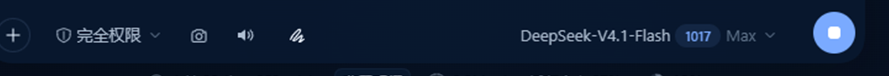

<div align="center">

# dsh-screenshot-button

**在 DSH 输入面板下方加一个截图按钮，点了就打开系统自带截图工具。**

[](LICENSE)
[](https://github.com/topics/dsh-plugin)

</div>

---

## 这是什么

`dsh-screenshot-button` 是 DeepSeek Harness（DSH）的一个小插件：

- 在 **composer 工具行（输入面板下方）** 注册一个相机图标按钮；
- 点一下，宿主进程会调起**操作系统自带的截图工具**；
- 框选完成后截图就在系统剪贴板里，回到输入框按 **Ctrl+V**（macOS `⌘V`）即可粘贴成图片附件。

不截屏、不读屏、不上传任何画面 —— 截图过程 100% 由系统工具完成，插件只负责"帮你按下那个按钮"。

## 界面

输入面板底部工具行里的相机按钮（`+` 与「完全权限」右侧）：



## 功能

| 能力 | 说明 |
| --- | --- |
| 一键唤起系统截图 | Windows 用 `ms-screenclip:`，macOS 用 `screencapture -i -c`，Linux 依次尝试 gnome-screenshot / spectacle / scrot |
| 主题自适应 | 按钮颜色全部走 DSH 主题 token（`--dsw-alias-*`），亮色/暗色自动跟随 |
| 中英文案 | 跟随页面 `html lang` 自动切换 |
| 防止连点 | 800ms 节流，避免叠开多个截图窗口 |
| 安全边界 | 路由只接受**本机回环 Host** 的 POST，拒绝跨站请求；手机/局域网访问无法触发本机弹窗 |

## 安装

### 方式一：从 GitHub 安装（推荐）

```bash
dsh plugin --profile <你的 profile> add github:SiriusWJ/dsh-screenshot-button
```

例如桌面版：

```bash
dsh plugin --profile desktop add github:SiriusWJ/dsh-screenshot-button
```

### 方式二：本地目录开发

```bash
git clone https://github.com/SiriusWJ/dsh-screenshot-button.git
dsh plugin --profile desktop add ./dsh-screenshot-button
```

或者在 DSH 里用插件管理器安装本地目录（`plugin_manager` → `install_bundle`，target 指向仓库根目录）。

安装后**重启 DSH**（客户端 bundle 在启动时扫描），输入框左下角就会出现相机按钮。

## 使用

1. 打开任意会话，把光标放在输入框；
2. 点输入框左下角的**相机按钮**；
3. 系统截图工具弹出 → 框选/标注/复制；
4. 回到输入框按 **Ctrl+V**，截图变成图片附件，输入文字后回车发送。

> 按钮只负责唤起系统工具，截图结果由系统放进剪贴板，所以粘贴这一步交给 DSH 官方的图片粘贴能力，兼容性和拖拽发图完全一致。

## 平台支持

| 平台 | 使用的系统工具 | 状态 |
| --- | --- | --- |
| Windows 10/11 | `ms-screenclip:`（截图工具 / 截图和草图） | 已实测 |
| macOS | `/usr/sbin/screencapture -i -c` | 按 API 实现，未实机验证 |
| Linux | gnome-screenshot / spectacle / scrot + wl-copy/xclip | 按 API 实现，未实机验证 |

不支持的平台会返回 `unsupported-platform`，按钮提示「当前系统没有可用的截图工具」。

## 工作原理

```
client (浏览器)                  host (DSH 进程)                系统
──────────────                  ───────────────                ────
点击相机按钮
  │  POST /dsh-screenshot/capture
  ├──────────────────────────────► 校验 Host 是本机回环
  │                                校验非跨站 / 同源
  │                                spawn(detached) ───────────► 截图工具弹出
  │  { ok: true, tool }             300ms 内无 error 即成功
  ◄──────────────────────────────┤
toast「已打开截图工具，Ctrl+V 粘贴」
```

### 插件结构

```
dsh-screenshot-button/
├── lib/index.js          # 宿主端：webServer 路由 + 调起系统工具
├── client/client.js      # 客户端：conversation.input.left 按钮
├── cordis.patch.yml      # bundle 补丁层
├── locale/{en,zh}.json   # 插件管理页标题/描述
├── icon.svg              # 插件图标
└── package.json
```

### 宿主路由

| 方法 | 路径 | 用途 |
| --- | --- | --- |
| `POST` | `/dsh-screenshot/capture` | 调起系统截图工具 |
| `GET` | `/dsh-screenshot/health` | 返回当前平台与可用截图入口，便于排查 |

## 常见问题

**Q：为什么点了按钮还要自己 Ctrl+V？**
系统截图工具把结果放进剪贴板，这是 Windows/macOS 截图工具的标准行为；DSH 官方输入框支持粘贴图片，所以这一步不需要插件介入。

**Q：为什么手机浏览器上看不到按钮？**
按钮本身会显示，但宿主路由只接受本机回环地址的请求（防止网页跨源弹本机窗口），所以远程访问时会提示「截图按钮只在本机 DSH 页面可用」。

**Q：能自动把截图插进输入框吗？**
当前版本不读取剪贴板（避免额外权限与隐私问题）。如果你需要"截完自动进输入框"，欢迎开 issue 讨论。

## 许可证

[MIT](LICENSE) © SiriusWJ

---

<details>
<summary><b>English</b></summary>

`dsh-screenshot-button` adds a small camera button under the DSH composer. Clicking it opens
the operating system's own screenshot tool (Windows `ms-screenclip:`, macOS `screencapture -i -c`,
Linux gnome-screenshot / spectacle / scrot). The shot lands in the system clipboard, so press
`Ctrl+V` in the composer to attach it. The plugin never captures the screen itself; the host route
only accepts loopback POSTs and rejects cross-site requests.

Install: `dsh plugin --profile <profile> add github:SiriusWJ/dsh-screenshot-button`

</details>
